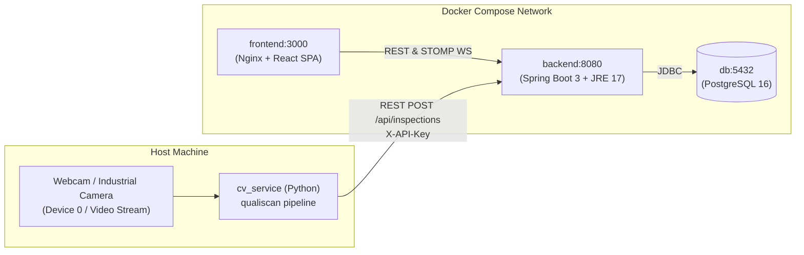

# QualiScan Docker Deployment Guide

This guide documents how to containerize and run the QualiScan inspection infrastructure using **Docker Compose**, and how to connect the host-based Computer Vision inspection pipeline.

---

## 1. System Architecture



- **Database (`db`)**: PostgreSQL 16 on port `5432` with automated healthchecks and persistent named volume `qualiscan_pgdata`.
- **Backend Service (`backend`)**: Spring Boot on port `8080` using profile `postgres`. Snapshot uploads persist in volume `qualiscan_uploads`.
- **Frontend Dashboard (`frontend`)**: Vite React dashboard served by Nginx on port `3000` with SPA routing fallback.
- **Computer Vision Pipeline (`cv_service`)**: **Runs directly on the host machine** because hardware camera interfaces (DirectShow on Windows, V4L2 on Linux) require physical device drivers and real-time capture performance. It streams telemetry to the containerized backend at `http://localhost:8080`.

---

## 2. Prerequisites

- [Docker Engine & Docker Compose v2+](https://docs.docker.com/get-docker/)
- Python 3.10+ (for running `cv_service` on the host)

---

## 3. Quick Start

### Step 1: Configure Environment Variables
Copy the template configuration file to `.env`:

```bash
cp .env.example .env
```

Open `.env` in your text editor and ensure the secrets are configured:
```dotenv
DB_NAME=qualiscan
DB_USER=qualiscan
DB_PASSWORD=qualiscan_secure_db_password_change_me
JWT_SECRET=QualiScan-Production-Super-Secret-Key-Must-Be-At-Least-32-Bytes!
VITE_API_URL=http://localhost:8080
```

> [!IMPORTANT]
> The `docker-compose.yml` enforces that both `DB_PASSWORD` and `JWT_SECRET` must be set in your `.env`. If either is missing, Docker Compose will fail immediately with a clear error message.

### Step 2: Build and Start Containers
Run Docker Compose in detached mode:

```bash
docker compose up --build -d
```

### Step 3: Verify Container Health
Check the container status:

```bash
docker compose ps
```

You should see:
- `qualiscan-db`: Up (healthy)
- `qualiscan-backend`: Up
- `qualiscan-frontend`: Up

### Step 4: Access the Dashboard
Open your web browser and navigate to:
**[http://localhost:3000](http://localhost:3000)**

Default seeded credentials:
- **Admin**: `admin` / `Admin@123`
- **Supervisor**: `supervisor` / `Super@123`
- **Operator**: `operator` / `Oper@123`

---

## 4. Connecting the Host Python CV Pipeline

The Python CV service processes high-frame-rate video feeds from your local camera and posts inspection results to `POST /api/inspections`. It authenticates using a device API key.

### How to Obtain the Device API Key

You can obtain a device API key via either of the following two methods:

#### Method A: From the Initial Startup Logs
When the backend starts up for the first time against an empty database, it automatically seeds `Line 1` and prints its plain-text API key once:

```bash
docker compose logs backend | grep -i "API key"
```

Look for output similar to:
```text
QualiScan Line 1 API key (shown once): qs_live_xxxxxxxxxxxxxxxxxxxxxxxx
```

#### Method B: Rotate Key via the Admin API
If the startup log is no longer available or you want to generate a new key:
1. Log in to the dashboard at `http://localhost:3000` as `admin` (`Admin@123`).
2. Alternatively, use `curl` to authenticate and rotate the key:

```bash
# 1. Obtain JWT token
TOKEN=$(curl -s -X POST http://localhost:8080/api/auth/login \
  -H "Content-Type: application/json" \
  -d '{"username":"admin","password":"Admin@123"}' | grep -o '"token":"[^"]*' | cut -d'"' -f4)

# 2. Rotate Line 1 API key
curl -X POST http://localhost:8080/api/lines/1/rotate-key \
  -H "Authorization: Bearer $TOKEN"
```

The response contains the newly generated plain-text device key.

### Running the Live Conveyor Pipeline on the Host

In your terminal, activate the Python virtual environment and run the live conveyor inspection pipeline:

```powershell
# From the repository root on Windows PowerShell:
cd cv_service
.\venv\Scripts\Activate.ps1

# Option 1: Run offline without backend (for testing camera/pipeline alone):
python tools/run_pipeline.py --source 0 --no-backend

# Option 2: Test with sample conveyor video (offline):
python tools/run_pipeline.py --source ../data/test_conveyor.mp4 --no-backend --loop

# Option 3: Stream to live Docker backend (replace "YOUR_KEY_HERE" with your actual key):
python tools/run_pipeline.py --source 0 --api-key "YOUR_KEY_HERE" --backend-url http://localhost:8080

# Or stream sample video to live Docker backend:
python tools/run_pipeline.py --source ../data/test_conveyor.mp4 --api-key "YOUR_KEY_HERE" --backend-url http://localhost:8080 --loop
```

Once running, the live dashboard at **[http://localhost:3000](http://localhost:3000)** will display real-time inspection telemetry, defect distributions, yield rates, and snapshot imagery over WebSocket.

---

## 5. Maintenance & Useful Commands

### Viewing Service Logs
```bash
# Stream all logs
docker compose logs -f

# Stream backend logs only
docker compose logs -f backend
```

### Stopping Services
```bash
# Stop containers while preserving database volume
docker compose down

# Stop containers and erase all persistent database data
docker compose down -v
```

---

## 6. Continuous Integration (CI)

The repository includes a automated GitHub Actions workflow in [`.github/workflows/ci.yml`](../.github/workflows/ci.yml) that verifies:
- **Backend:** Java 17 test suite via `./mvnw -B test`.
- **CV Service:** Python 3.12 unit tests using `pytest -q` with `opencv-python-headless`.
- **Frontend:** Node.js 20 Vitest test suite (`npm test -- --run`) and production build (`npm run build`).

### CI Status Badge

You can embed this status badge in `README.md`:

```markdown
[](https://github.com/AdityaPatel-25/QualiScan/actions/workflows/ci.yml)
```
