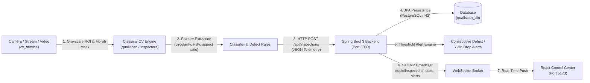

# QualiScan — Project Context & System Architecture

## 1. Project Overview
**QualiScan** is an end-to-end, real-time industrial defect inspection and quality assurance system tailored for small-to-medium manufacturing conveyor lines. 

The system leverages **classical computer vision (OpenCV)** running on commodity hardware to inspect mixed product streams, extract geometric and color features, classify product types, evaluate domain-specific quality rules, and stream real-time telemetry to a centralized control center.

---

## 2. Target Products & Defect Specifications

The system inspects items across three primary product categories moving on a continuous conveyor belt:

### A. Bottle Caps (`BOTTLE_CAP`)
* **Nominal Geometry**: Circular, uniform diameter (~45–55mm), high circularity ($\ge 0.82$).
* **Defect Classes**:
  1. `DEFORMED_RIM`: Asymmetric perimeter deformation, high eccentricity, or radial variance.
  2. `MISSING_INNER_SEAL`: Absence of the inner sealing ring detected via Hough Circles or concentric thresholding.
  3. `SURFACE_CRACK`: High-gradient edge contours within the central face detected via Laplacian/Sobel filtering.
  4. `UNDERSIZED`: Outer bounding circle diameter falling below tolerance.

### B. Printed Cards (`PRINTED_CARD`)
* **Nominal Geometry**: Rectangular, aspect ratio ~1.40–1.75, high solidity ($\ge 0.90$).
* **Defect Classes**:
  1. `DAMAGED_CORNER`: Clipped, rounded, or torn corners identified by comparing the contour against its minimum bounding box corners.
  2. `SURFACE_SCRATCH`: Linear surface flaws identified via morphological line detectors and Hough Transform accumulators.
  3. `MISPRINT_OR_BLANK`: Significant deviations in internal texture variance, edge density, or color histogram distribution.
  4. `INVALID_ASPECT_RATIO`: Dimensional ratio anomalies outside the calibrated 1.30–1.85 tolerance.

### C. Biscuits (`BISCUIT`)
* **Nominal Geometry**: Circular/elliptical baked goods with standard docking hole patterns.
* **Defect Classes**:
  1. `BROKEN_OR_CHIPPED`: Missing edge sections detected via convex hull convexity defect analysis.
  2. `BURNT`: Low Value ($V$) and high Saturation ($S$) in HSV color space exceeding darkness thresholds.
  3. `UNDERCOOKED`: Excessively high Value ($V$) and low Saturation ($S$) indicating insufficient baking.
  4. `MISSING_DOCKING_HOLES`: Inadequate count or distribution of aeration steam vents detected via blob detection inside the biscuit body.

---

## 3. Technology Stack & Multi-Tier Architecture

### Module Breakdown
1. **Computer Vision Service (`cv_service/`)**:
   * **Python 3.14+**, `opencv-python`, `numpy`.
   * Fast, sub-15ms frame processing on standard CPU without dedicated GPU hardware.
   * Deterministic, explainable decisions with physical metrics (circularity, area, aspect ratio, HSV mean).
   * Interactive exploration and labeling tool in `cv_service/tools/explore.py`.
2. **Backend Service (`backend/`)**:
   * **Spring Boot 3.3.4**, Java 17+, Maven.
   * REST endpoints for inspection ingest (`POST /api/inspections`), metrics querying, and alert handling.
   * STOMP WebSocket messaging (`/ws-qualiscan`) for sub-second reactive updates.
   * Spring Security with stateless HMAC-SHA256 JWT tokens.
3. **Frontend Dashboard (`frontend/`)**:
   * **React 18**, Vite.
   * Real-time conveyor visualization, KPI metrics (Yield rate, pass/fail counts).
   * Live Pareto defect distribution chart.
   * Explainability modal detailing the exact CV rules triggered for each rejection.
4. **Data & Profiles (`data/`, `cv_service/profiles/`)**:
   * Feature telemetry CSVs (`data/features.csv`).
   * Raw image samples for unit tests and calibration (`data/raw/`).

---

## 4. Phase Structure & Reference Repository
* **Active Working State**: Focused on `cv_service/` development, contour segmentation (`qualiscan.segment`), and exploratory data collection (`tools/explore.py`).
* **Future Phases Archive (`.backup_future_phases/`)**: Contains full working implementations of all downstream components:
  * `.backup_future_phases/cv_service/`: Full inspectors (`bottle_cap`, `printed_card`, `biscuit`), `classifier.py`, `pipeline.py`, and synthetic dataset generator.
  * `.backup_future_phases/backend/`: Complete Spring Boot Maven project with entities, repositories, WebSocket push, and JWT auth.
  * `.backup_future_phases/frontend/`: Complete Vite React industrial dashboard.
  * `.backup_future_phases/data/`: Full sample dataset with labelled defect categories.
